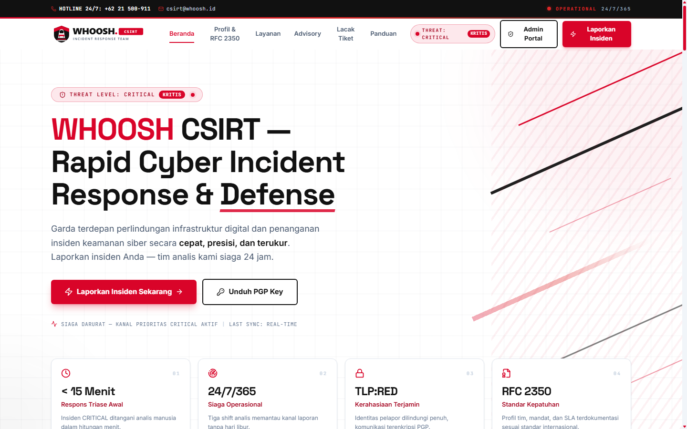
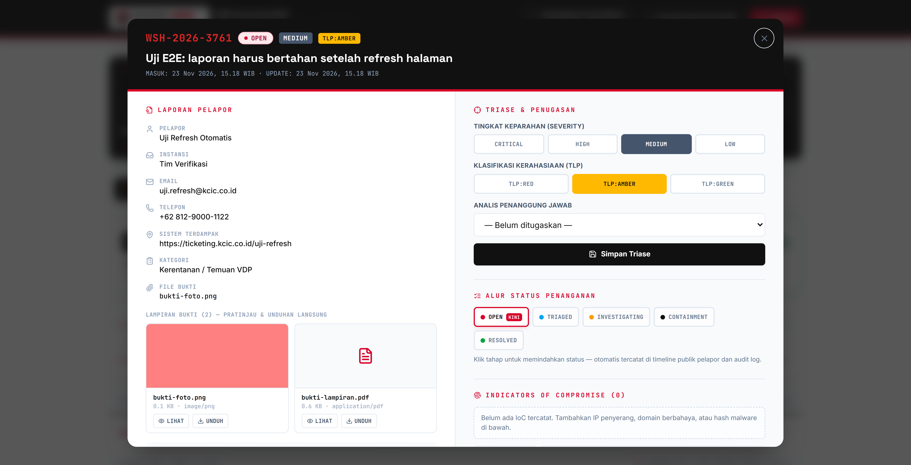
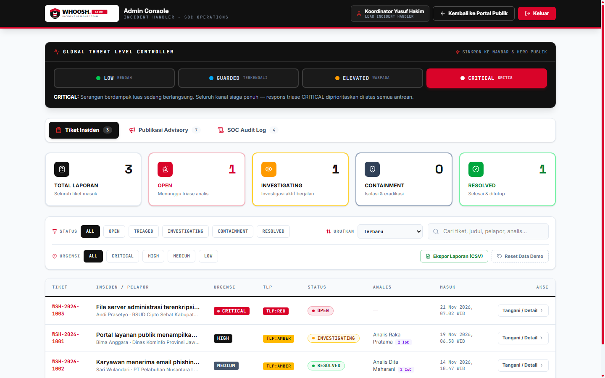
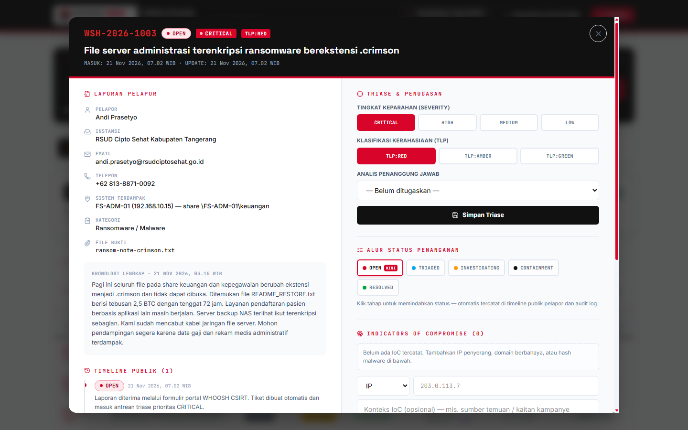
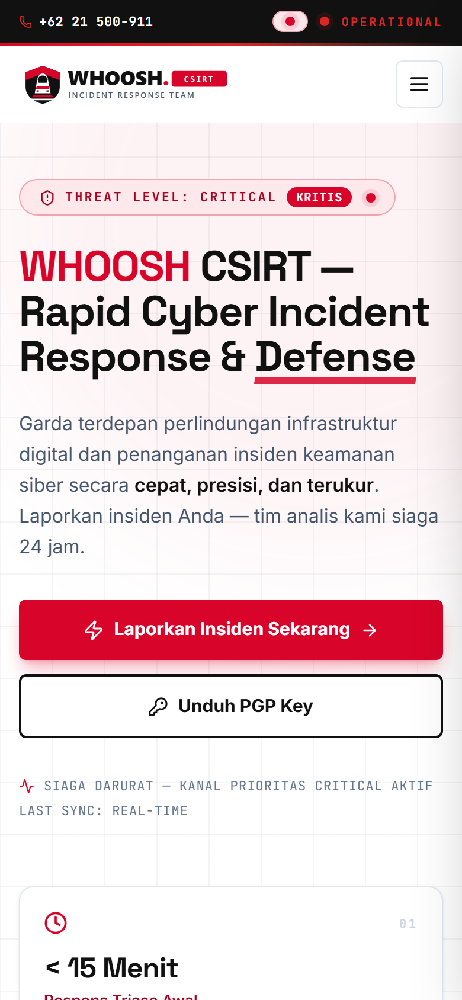

# WHOOSH CSIRT — Portal Operasional & Konsol SOC

<p align="center">
  
</p>

<p align="center">
  <strong>Portal Operasional Computer Security Incident Response Team</strong><br>
  Vulnerability Disclosure Program (VDP) — KCIC / Whoosh Jakarta–Bandung
</p>

<p align="center">
  
  
  
  
  
  
</p>

---

## Sekilas

**WHOOSH CSIRT** merupakan portal operasional CSIRT dan Vulnerability Disclosure Program (VDP) bersifat **non-komersial**, menggunakan kerangka RFC 2350 untuk kebutuhan simulasi pelaporan insiden keamanan dan temuan kerentanan pada aset KCIC / Whoosh Jakarta–Bandung.

Platform terdiri dari dua permukaan operasional yang sengaja dipisahkan:

| Permukaan | Audiens | Fitur |
|---|---|---|
| **Portal Publik** | Pelapor, peneliti keamanan, penumpang | Pelaporan insiden, unggah bukti, pelacakan tiket, advisory keamanan, ruang lingkup RFC 2350, FAQ, dan panduan darurat |
| **Konsol SOC** | Tim internal (Lead Handler & SOC Analyst) | Triase, klasifikasi TLP/severity, manajemen tiket, timeline insiden, IoC, integrasi NVD/CVE, audit log, ekspor CSV, dan publikasi advisory |

Konsol SOC tidak ditautkan dari halaman publik. Akses konsol ditujukan untuk tim internal yang berwenang.

### Preview — Portal Publik

<p align="center">
  
</p>

---

## Fitur Unggulan

### 1. Pelaporan Insiden dengan Bukti Multi-format

Pelapor dapat mengunggah hingga **4 file bukti** dengan dukungan format:

- PNG, JPG, WebP, GIF
- PDF
- DOC / DOCX
- TXT / CSV / LOG
- EML
- ZIP
- PCAP

Batas ukuran maksimal adalah 2 MB per file.

Analis SOC dapat melihat pratinjau lampiran secara langsung, termasuk thumbnail gambar dan ikon dokumen, serta mengunduh bukti melalui modal penanganan tiket.

<p align="center">
  
</p>

### 2. Persistensi Data dan Sinkronisasi Lintas Browser

Sistem menggunakan tiga lapisan persistensi:

1. **Penyimpanan lampiran terpisah**  
   File disimpan menggunakan kunci `whoosh-csirt:att:v1:<id>` agar tidak membebani data JSON insiden.

2. **Metadata insiden ringkas**  
   Data insiden disimpan pada `whoosh-csirt:incidents:v1`. Jika kuota penyimpanan penuh, lampiran yang gagal disimpan ditandai sebagai `evicted`, sementara data laporan tetap dipertahankan.

3. **Sinkronisasi sisi server**  
   Endpoint `/api/whoosh-state` melalui middleware Vite menyimpan snapshot ke `.data/whoosh-csirt-state.json`.

Dengan mekanisme ini, data yang dimasukkan melalui satu browser dapat dibaca melalui browser lain selama keduanya terhubung ke server demo yang sama.

Sinkronisasi antar-tab juga didukung melalui event `storage`. Jika server tidak tersedia, aplikasi menggunakan `localStorage` sebagai fallback.

### 3. Konsol SOC dengan Role-Based Access Control

Terdapat dua peran utama:

- **Lead Incident Handler**
- **SOC Analyst Tier-1**

Setiap aktivitas sensitif dicatat melalui SOC Audit Log, termasuk:

- Login dan logout.
- Triase dan perubahan status insiden.
- Penambahan catatan dan IoC.
- Impor data NVD.
- Ekspor laporan CSV.
- Reset data demo.

<p align="center">
  
</p>

### 4. Intelijen Kerentanan dari NVD

Penjelajah CVE terintegrasi dengan NVD API untuk mengambil informasi kerentanan secara live melalui proxy server.

Fitur meliputi:

- Pencarian CVE.
- Informasi CVSS dan severity.
- CVE vector.
- Ringkasan kerentanan.
- Dataset demo offline sebagai fallback.
- Pengaitan CVE dengan tiket insiden.
- Publikasi advisory keamanan.

<p align="center">
  
</p>

### 5. Responsive Interface

Seluruh antarmuka dirancang dengan pendekatan mobile-first, termasuk portal publik, formulir pelaporan, dashboard SOC, dan modal penanganan insiden.

<p align="center">
  
</p>

---

## Stack Teknologi

| Lapisan | Teknologi |
|---|---|
| Frontend | React 19 |
| Bahasa | TypeScript 5.8 Strict |
| Build Tool | Vite 7 |
| Styling | Tailwind CSS v4 |
| Icon | lucide-react |
| State Management | React Context |
| Persistensi | localStorage + Server-side State |
| Vulnerability Intelligence | NVD CVE API |
| Demo Video | Remotion |

---

## Struktur Proyek

```text
WHOOSH-CSIRT/
├── public/
│   └── assets/
├── docs/
│   └── images/
│       ├── logo-lockup.svg
│       ├── public-hero.png
│       ├── evidence-attachments.png
│       ├── admin-dashboard.png
│       ├── admin-work-modal.png
│       └── mobile-hero.png
├── src/
│   ├── components/
│   ├── context/
│   ├── data/
│   ├── services/
│   └── types/
├── remotion-demo/
├── vite.config.ts
├── login.md
├── package.json
└── README.md
```

---

## Menjalankan Secara Lokal

### Prasyarat

- Node.js >= 20.19
- npm
- NVD API Key (opsional)

### 1. Clone Repository

```bash
git clone <URL-REPOSITORY>
cd WHOOSH-CSIRT
```

### 2. Install Dependencies

```bash
npm install
```

### 3. Konfigurasi Environment

Buat file `.env` pada direktori utama proyek:

```env
VITE_NVD_API_KEY=API_KEY_ANDA
VITE_NVD_API_BASE_URL=https://services.nvd.nist.gov/rest/json/cves/2.0
```

Jangan mengunggah file `.env` yang berisi API key ke repository publik.

### 4. Jalankan Development Server

```bash
npm run dev
```

Akses aplikasi melalui:

```text
http://localhost:5173
```

### 5. Build Produksi

```bash
npm run build
```

### 6. Preview Build

```bash
npm run preview
```

NVD API Key dapat diperoleh secara gratis melalui:

https://nvd.nist.gov/developers/api-keys

Aplikasi tetap dapat berjalan menggunakan dataset demo offline apabila API Key tidak tersedia.

---

## Video Demo

Video demo dibuat menggunakan Remotion dengan durasi sekitar 60 detik dan empat bagian presentasi.

Untuk melakukan rendering:

```bash
cd remotion-demo

npx remotion render src/index.ts DemoVideo out/whoosh-csirt-demo.mp4 --overwrite --log=warn
```

---

## Data Demo dan Kredensial

Aplikasi menggunakan data dummy untuk kebutuhan demonstrasi, termasuk:

- 3 tiket insiden contoh.
- 7 advisory keamanan.
- Audit log.
- Threat Level: ELEVATED.

Data demo dapat dikembalikan menggunakan fitur **Reset Demo** pada konsol SOC.

### Kredensial Demo

| Peran | Email | PIN |
|---|---|---|
| Lead Incident Handler | `handler@kcic.co.id` | `2026` |
| SOC Analyst Tier-1 | `analyst@kcic.co.id` | `1122` |

Detail tambahan tersedia pada file `login.md`.

> **Catatan:** Kredensial di atas hanya untuk demonstrasi. Jangan menggunakan autentikasi demo ini sebagai mekanisme keamanan untuk sistem produksi.

---

## Keamanan dan Ruang Lingkup

### Vulnerability Disclosure Program

Ruang lingkup simulasi VDP dibatasi pada aset KCIC / Whoosh, termasuk domain dan subdomain `kcic.co.id`, sistem digital Whoosh, serta infrastruktur terkait yang secara eksplisit memperoleh otorisasi pengujian.

Laporan di luar cakupan diarahkan kepada pemilik sistem atau CSIRT yang berwenang.

### Klasifikasi TLP

Setiap tiket mendukung klasifikasi:

- TLP:RED
- TLP:AMBER
- TLP:GREEN

Informasi operasional dan postur ancaman internal hanya ditampilkan pada konsol SOC.

### Perlindungan Data

- File `.env` dikecualikan dari repository.
- API Key NVD digunakan melalui mekanisme proxy server.
- Barang bukti disimpan pada penyimpanan lokal aplikasi demo.
- Tidak ada unggahan bukti ke layanan pihak ketiga secara otomatis.

---

## Disclaimer

WHOOSH CSIRT merupakan proyek demonstrasi dan portofolio untuk pembelajaran serta simulasi operasional Computer Security Incident Response Team.

Seluruh tiket, identitas pelapor, advisory, IoC, dan kredensial yang ditampilkan merupakan data fiktif untuk keperluan demonstrasi.

**Proyek ini bukan portal resmi KCIC / Whoosh dan tidak menyatakan adanya afiliasi, kerja sama, maupun pengesahan resmi dari pihak terkait.**

Seluruh aktivitas pengujian keamanan wajib dilakukan berdasarkan izin tertulis dan ruang lingkup yang telah disepakati.

---

<p align="center">
  <strong>WHOOSH CSIRT</strong><br>
  Security Operations • Incident Response • Vulnerability Disclosure
</p>
